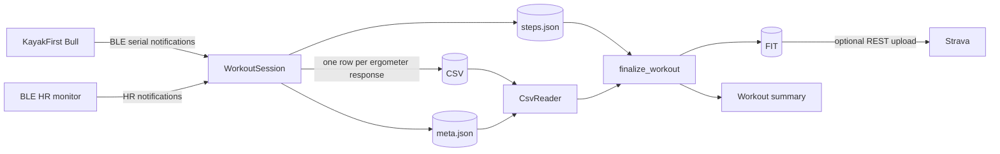

# KayakFit architecture

This document describes the current system design from BLE capture through CSV,
FIT, summary, and Strava. The user-facing calculation path is documented in
[DATA_TRANSFORMATIONS.md](DATA_TRANSFORMATIONS.md). Design rationale is in
[DECISIONS.md](DECISIONS.md), user-visible behavior is in
[FEATURES.md](FEATURES.md), and known defects are in [ROADMAP.md](ROADMAP.md).

## System context

KayakFit is a Python 3.14 desktop application for macOS and Windows. The process
contains one CustomTkinter UI thread and, at most, one active background worker
managed by `gui.worker_manager.WorkerManager`.



Top-level entry points:

- `kayakfit_gui.py` configures logging/crash diagnostics and starts Tk.
- `workout_worker.py` creates the async recording session in a worker thread.
- `export_worker.py` converts CSV to FIT and optionally uploads it.

## UI composition and thread model

`gui.main_gui.KayakFitGUI` constructs the root window and combines four behavior
mixins:

- `RecordingLifecycleMixin` — start/stop, live metrics, completion, recovery.
- `ProgramPanelMixin` — selected program, step progress, targets, cues.
- `DeviceStatusMixin` — connection, HR zone, pause, and upload state.
- `ExportUploadMixin` — FIT/export/upload actions and config refresh.

`gui._mixin_base.GuiSharedState` exists only under `TYPE_CHECKING` to describe
the remaining widget/method surface shared by these mixins. Mutable recording,
program, and export state has explicit owners in `gui.controllers`; it no
longer lives as unrelated attributes on the root window.

`gui.history_window` lists canonical CSV recordings and selected external
CSV/FIT files. Its small `Plan`/`Free` badge reads the required versioned
metadata workout mode. Invalid CSV metadata receives an `Invalid` badge.
Imported FIT files use a neutral `FIT` badge because the
original workout mode is not encoded reliably enough to infer it.
Its search is an in-memory filter over the bounded visible list; it does not
introduce a workout index or database.

Workout summaries load and compute on a short-lived background thread. Only
the resulting immutable-style summary model crosses back to Tk for widget
construction. Charts retain full-resolution series for statistics and hover
inspection, while their Canvas polylines use cached pixel-width min/max
downsampling and debounced resize redraws.

BLE, FIT, and HTTP work never runs directly in a Tk callback. `WorkerManager`
owns a daemon thread, stop/advance `threading.Event` objects, and event
marshalling. Each worker returns exactly one `WorkerResult`: thread completion
is not treated as successful work. Outcomes distinguish success, cancellation,
partial durable output, failure, and pending external processing.
Callbacks are marshalled through `widget.after(0, ...)`. `app.events` defines
the typed status, metrics, and terminal-event contracts crossing the worker/UI
boundary.

## Configuration and user data

`gui.config_manager.ConfigManager` is the shared config persistence boundary.

```text
~/KayakFit/
  config.yml
  .active_workout.json
  logs/
  programs/
  workouts/<year>/
```

- YAML is loaded with `safe_load` and merged with canonical defaults.
- Config writes use an owner-only temporary file and atomic replacement.
- Strava authorization is an atomic bundle (client ID, client secret, access
  token, refresh token, and expiry) stored through `app.secret_store` in the
  operating-system credential vault where available. A connection is valid
  only when the full bundle is present. The owner-only YAML file is the fallback.
- Runtime workers validate the configured ergometer and weight types before a
  session begins.
- `ConfigManager.validate_config()` owns the complete range/type validation used
  by settings and both workers. Invalid explicit values fail rather than being
  silently replaced.

Per-workout `metadata.json` records processing inputs so later exports do not
silently change when current configuration changes.

## BLE layer

### Common lifecycle

`app.ble_device.BleDevice` provides:

- bounded connect attempts with exponential backoff;
- reuse of an already-discovered `BLEDevice`, avoiding implicit address scans;
- notification subscription;
- unexpected-disconnect callbacks;
- repeated mid-session reconnect attempts;
- stop-aware teardown;
- structured device status callbacks.

Before opening a fresh client it closes any previous half-open connection. A
deliberate disconnect sets `_should_run = False` before closing so the
disconnected callback does not start another reconnect loop.

### Ergometer protocol

`app.kayakfirst_ergometer_bluetooth.KayakFirstErgometer` uses a serial-style BLE
characteristic. Commands are ASCII, semicolon-separated, CRLF-terminated, and
written in 20-byte chunks.

Initial connection performs the firmware sequence:

1. reset;
2. second reset;
3. time/timezone/person-weight/boat-weight handshake;
4. five-slot display configuration;
5. workout start.

The application then sends a poll command approximately once per second. Each
data response is reassembled from an arbitrary BLE notification stream: one
notification can contain several lines or a partial line. Complete `\r\n`
records are parsed in order, partial bytes remain buffered, and an unterminated
oversized buffer is discarded. Reconnect clears the partial buffer but does not
repeat the reset/handshake, to avoid resetting an in-progress ergometer workout.

Parsed fields include cumulative distance, elapsed time, instantaneous and
averaged speed/cadence/pace/force, sample window, and active-paddling state. A
central positional map in `app.field_mapping` owns the protocol-to-column names.

### Heart-rate monitor

`app.heart_rate_monitor_bluetooth.HeartRateMonitor` uses the standard BLE Heart Rate
Measurement characteristic and optional Battery Level characteristic. It
decodes both 8-bit and 16-bit HR values from the flags byte.

At workout startup, `WorkoutSession` resolves the configured HRM before opening
the ergometer link. The resolved backend device is then reused for the initial
HRM connection and reconnects, so Bleak does not need to scan for the HRM while
another BLE connection is active. Discovery is attempted twice before the user
is offered an ergometer-only workout.

HR notifications are free-running and asynchronous. They update
`WorkoutSession.latest_heart_rate`; they do not produce CSV rows. A failed
optional HRM connection can be accepted by the user, allowing an ergometer-only
workout.

## Recording pipeline

`app.workout_session.WorkoutSession` owns the live session:

1. Establish an epoch anchor, monotonic anchor, and `RecordingTimeline`.
2. Reserve a timestamped directory under the year and open `workout.csv` in it.
3. Save processing metadata and mark the workout recoverable.
4. Connect/start the ergometer and optional HRM.
5. For each ergometer record:
   - persist the canonical endpoint and non-overlapping represented duration;
   - attach the latest HR only while it is fresh;
   - append the full protocol row to CSV;
   - update the live free-workout segmenter;
   - update the planned-program runner when present;
   - emit live metrics/status to the GUI.
6. On stop, send the device stop command, disconnect, close/fsync the CSV,
   finalize any planned step, and emit the completion summary.

CSV rows are flushed immediately and periodically fsynced. The active recovery
marker points at the current CSV so the next launch can offer FIT conversion
after a crash. A row-write failure places the writer in a terminal failed state,
stops the session, retains the last durable rows for recovery, and prevents a
false successful save/export result.

HR freshness is measured entirely with monotonic receipt and processing times;
epoch time is used only for recorded timestamps.

## Raw CSV model

`app.write_csv.CsvWriter` writes every field from `app.field_mapping.CSV_COLUMNS`
using a semicolon delimiter. It does not decide which records count as activity.

`app.read_csv.CsvReader`:

- requires the exact v1 schema;
- parses values defensively;
- skips individually corrupt/truncated rows;
- rejects a predominantly corrupt file;
- preserves stationary and repeated valid rows;
- projects instantaneous cadence, pull force, and speed for processing;
- returns the small stdlib-only `app.table.Table` abstraction.

The CSV remains the durable observation source even after FIT generation.

## Activity selection and finalization

`app.segmentation` and `app.finalized_workout` have separate responsibilities:

- `LiveSegmenter` presents a pause after five continuous inactive seconds.
- `resolve_segments()` determines exact active runs for final processing.
- `finalize_workout()` creates the complete domain consumed by FIT and summary.

`active_paddling` is required and authoritative. Every positive sample is
active; every zero sample is inactive. Speed, cadence, HR, and cumulative
distance never infer timer state.

A finalized workout contains:

- a canonical represented interval and epoch endpoint for every row;
- exact contiguous active segments;
- active record indices;
- FIT/summary lap groups;
- chart break indices;
- total active timer time;
- complete elapsed-zero to final-record session time;
- cumulative distance at the last active record.
- an explicit represented duration for every emitted record.

Activity runs and laps are frozen typed records. Finalization is a small
orchestrator over pure phases for sample windows, active distance, planned/free
lap construction, chart breaks, and conservation/rounding.

Each row represents `[session_elapsed__s - sample_duration__s,
session_elapsed__s]`. `timestamp` is the same endpoint on the session epoch.
Raw device timing is diagnostic only. Session timer time is the sum of active
represented windows; inactive and uncovered time remains elapsed time.

The planned lap totals must conserve the finalized session's active timer time
and distance. Invalid or incomplete timelines fail processing instead of
silently changing workout type or omitting samples.

### Free workouts

Exact runs own FIT timer events and active metrics. Every inactive record closes
the current exact run; every following active record starts another. Free laps,
the live pause/lap state, and free-workout chart lines use a fixed five-second
meaningful-pause delay: shorter inactive or uncovered gaps remain inside the
same presented lap. The threshold uses canonical elapsed time, not packet count,
and is not configurable. Inactive records remain excluded from active time and
averages even when the surrounding exact runs share a lap.

### Planned workouts

`app.program` loads JSON into flattened `Program`/`Step` models. Repeat depth,
expansion work, and total steps are bounded. `ProgramRunner` consumes ergometer
elapsed time and cumulative distance on each sensor sample. Open steps require a
manual advance.

`WorkoutSession` records strict canonical session-elapsed step boundaries in
`steps.json`; epoch boundary fields are not part of v1.
Transition and final boundaries are persisted immediately; an open step is
checkpointed at a bounded interval rather than fsyncing its sidecar for every
sensor sample.
Finalization uses those boundaries to create a lap for every performed step;
active selection remains independent. A fully inactive rest produces an empty
step lap. Planned-workout metadata requires a complete, valid sidecar; a missing
or unusable timeline fails closed instead of silently changing the workout to
free-workout grouping.

Time steps are driven by canonical session elapsed time rather than an
independent periodic wall clock. A delayed sample can cross multiple boundaries:
`ProgramRunner` preserves its overshoot and reports every exact transition.
Finalization intersects each represented sample window with performed step
intervals, so timer time, metrics, and distance are apportioned conservatively.

## Statistics and power

`app.workout_metrics.compute_finalized_metrics()` is the final FIT/summary
aggregate boundary, using `app.stats.aggregate_metrics()` for each session/lap
slice. HR, instantaneous cadence, and estimated power use positive valid
readings and active-overlap weights. Power is derived per record from
instantaneous cadence and pull force. `app.active_distance.ActiveDistanceAccumulator` owns
active distance/time attribution for both finalization and the live dashboard.
Speed uses the independent recorded instantaneous channel (`app.speed_series`,
D017): averages are weighted by active represented intervals and maxima are
raw active peaks. FIT and summary charts carry those unsmoothed points.
HR-zone time is accumulated over active segments only, with missing-HR time
presented separately.

Power is estimated by `app.power`:

```text
power_W = pull_force_N × pull_length_m × cadence_spm / 60
```

The default effective pull length is 0.600 m. See
[POWER_MODEL.md](POWER_MODEL.md). Pull length is an explicit processing input
recorded in workout metadata, so historical output is independent of later
configuration changes.

## FIT construction

`app.export_fit.FitExporter` loads recorded metadata, reads `workout.csv`, loads
`steps.json`, and finalizes the workout. A stationary recording with no
active segment is rejected rather than fabricated into an activity.

FIT message order is:

1. file ID;
2. device information;
3. timer START/STOP events around each exact active run, one metric-free GPS
   anchor at each START, and active sensor records in chronological order;
4. lap messages for planned steps or natural laps;
5. one session message.

Records contain timestamp, active-only cumulative distance, instantaneous speed,
HR, instantaneous cadence, estimated power from instantaneous cadence/force when
available, and a synthetic position on the 2 km Hazewinkel
course derived from that same cumulative distance. Strava uses the positions to
calculate kayaking overview moving time across pauses. Because sensor samples
represent windows ending at their timestamps, a metric-free record anchors the
previous distance and position at every active-run START; otherwise Strava
drops that run's first window. The session/laps contain timer and elapsed time,
distance, averages, and maxima. No calories or altitude are generated.

FIT is built to `<name>.fit.tmp` and atomically promoted to `<name>.fit`. A
failed rebuild leaves a previous FIT untouched.

## Summary construction

`app.summary.compute_summary()` consumes the same finalized workout and shared
statistics as FIT construction. It returns active, elapsed and pause totals;
lap active/elapsed time and following gaps; headline values, HR-zone seconds,
exact emitted-record series, chart breaks, and planned step bands. Session
elapsed time reconciles as the sum of lap elapsed time plus following gaps.

`gui.summary_window` renders that model with CustomTkinter and a plain Tk Canvas.
Each chart point uses the CSV sample endpoint, exactly matching the timestamp of
its FIT sensor record. The FIT timer can begin one represented sample window
before the first point because the record describes the interval ending there.
Time-based planned workouts render their phases once in a compact strip above
the metric panels. Step boundaries are shared alignment guides across those
panels; the old per-panel phase fills are intentionally not repeated. Distance
mode omits the strip because elapsed-time boundaries have no exact distance-axis
mapping.

Headline and split aggregates are verified against decoded FIT output. Charts
show raw recorded points; legend averages, maxima, and average lines consume
the authoritative `WorkoutSummary` aggregates.

## Strava and external state

`app.strava_api` is the only HTTP boundary. `StravaAuth` implements an OAuth
authorization-code flow with a loopback listener on `127.0.0.1`, per-flow state,
and manual code fallback. `StravaUploader` refreshes tokens, sends multipart FIT
uploads with a stable external ID, polls processing status, and reads back a
confirmed activity when possible.

An accepted upload whose poll exceeds the deadline returns `pending=True`.
Pending is not the same as confirmed success. The upload ID is not currently
persisted, so polling cannot resume after a restart; see ROADMAP P1.

## Recovery and shutdown

On startup, a valid active-workout marker identifies a workout directory whose
`workout.csv` contains at least one row, producing a recovery prompt. The user
can convert it to FIT and optionally upload it. Missing/empty targets self-clear.

During application shutdown, the GUI signals the active worker and waits a
bounded period for recording teardown or an in-flight external operation. Logs
and `faulthandler` preserve Python and native crash information for windowed
builds.

## Verification boundaries

Automated coverage includes BLE packet framing, program parsing/progression,
CSV parsing, recovery, segmentation, HR zones, shared statistics, FIT events,
planned/free laps, summary behavior, decoded FIT parity, and mocked Strava REST
flows.

The suite does not prove:

- behavior against physical BLE hardware and firmware variants;
- live Strava service compatibility;
- CustomTkinter interactions and window teardown races;
- disk-full or permission-loss behavior;
- packaged application behavior on every OS version;
- long-workout chart responsiveness.
